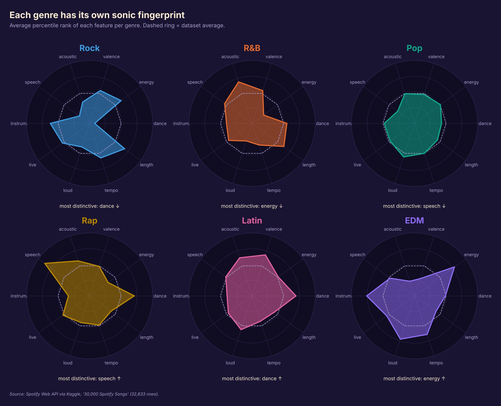
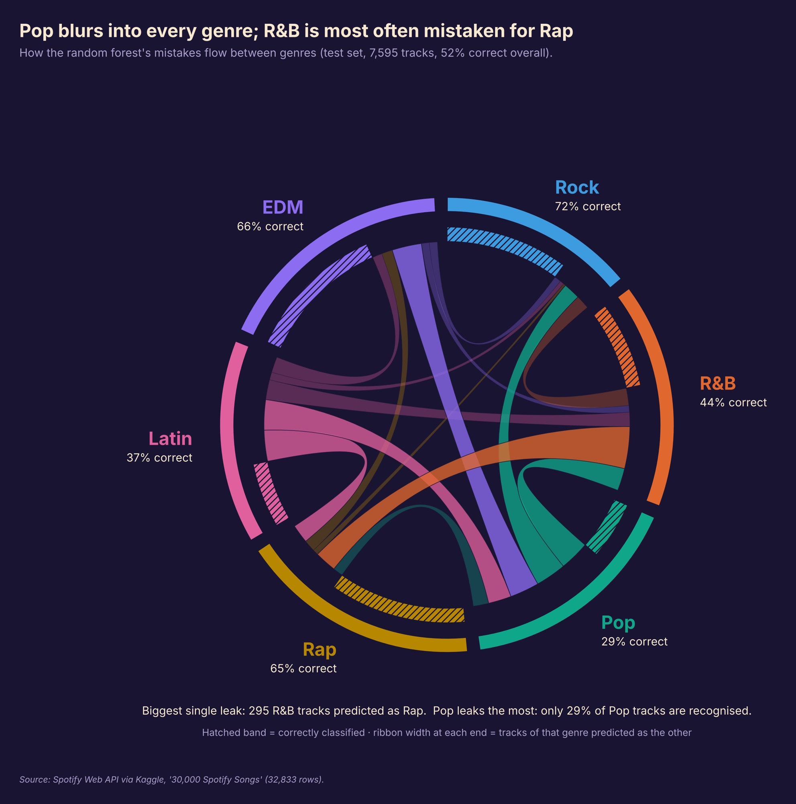
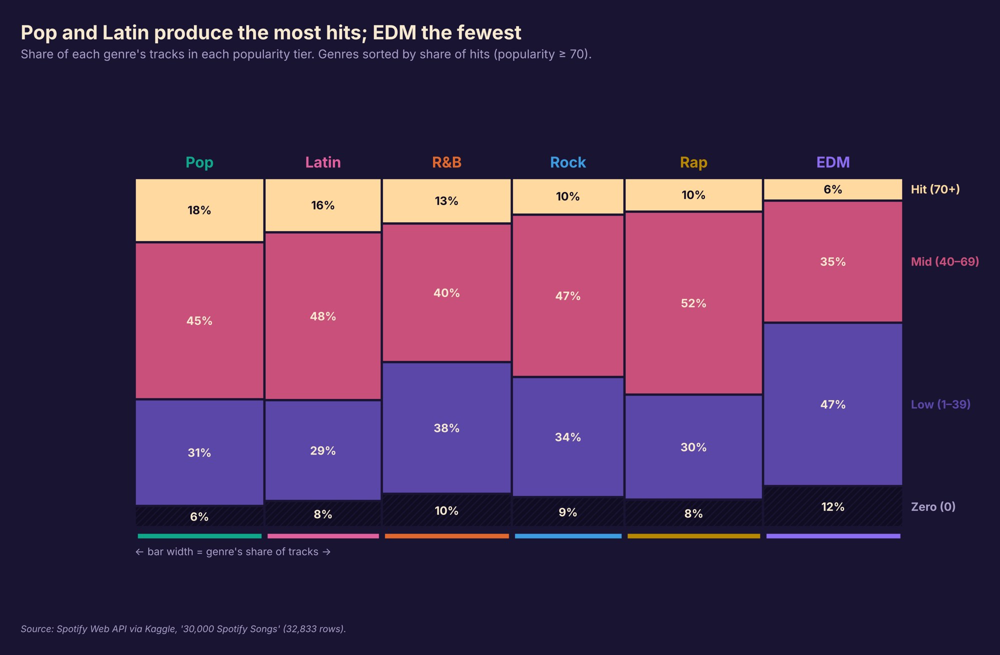
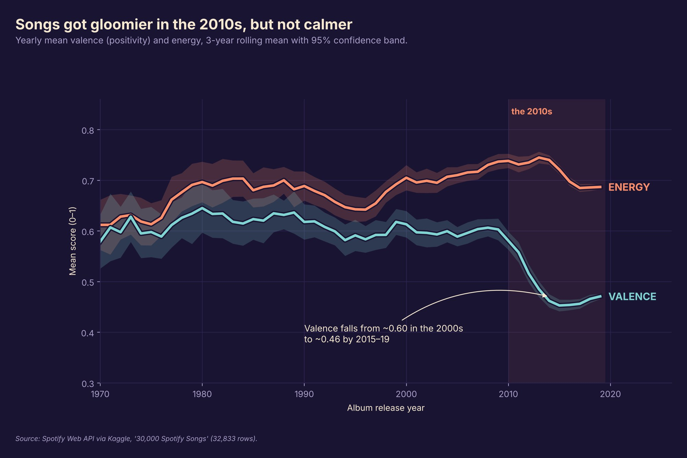
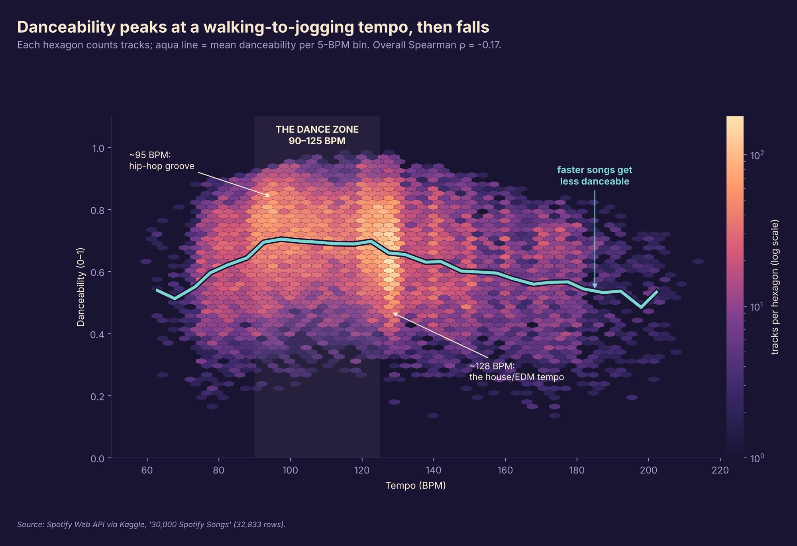

<div align="center">

# Mapping the Spotify Soundscape

**What do Spotify's audio features reveal about genres, popularity, mood and tempo?**

*COMP 6934 · Introduction to Data Visualization · Memorial University of Newfoundland · Fall 2026*



</div>

---

## Summary

> Spotify's audio features capture **what a genre sounds like**, and **how music's mood has darkened**, but they say surprisingly little about **what makes a song popular**.

We followed ten audio features (danceability, energy, valence, acousticness, speechiness, instrumentalness, liveness, loudness, tempo and duration) through **28,352 tracks** across **6 genres** and **24 sub-genres**. The result is a scroll-driven visual story with 15 figures and one interactive chart.

## Research questions and findings

| | Question | Finding |
|:-:|---|---|
| **Q1** | Which genres are the most popular? | **Pop leads (45.9), EDM trails (34.1)**, but the spread inside each genre is far wider than the gaps between them. |
| **Q2** | Which audio features go with popularity? | **None in a meaningful way.** Every Spearman correlation has \|ρ\| < 0.2, and hits sound much like flops. |
| **Q3** | What makes a genre sound like itself? | **Danceability, tempo and speechiness.** A random forest using audio alone gets 52% right (chance ≈ 17%). Rock is easy to recognise; Pop blends into everything. |
| **Q4** | Has music become sadder? | **Yes, in the 2010s.** Valence fell from about 0.60 to about 0.46, and it fell inside all six genres, while energy stayed high. |
| **Q5** | Does a faster song make you dance more? | **Only up to a point.** Danceability peaks at 90–125 BPM and declines for faster songs. |

## Selected visualizations

<table>
  <tr>
    <td width="50%"><br><sub><b>Chord diagram:</b> where the genre classifier gets confused</sub></td>
    <td width="50%"><br><sub><b>Marimekko chart:</b> where the hits come from</sub></td>
  </tr>
  <tr>
    <td><br><sub><b>Line chart with CI bands:</b> fifty years of musical mood</sub></td>
    <td><br><sub><b>Hexbin density:</b> the danceable tempo zone</sub></td>
  </tr>
</table>

**All 15 charts:** waffle (per genre) · sunburst · small-multiple histograms · ridgeline · Marimekko · diverging lollipop · radar · radar small multiples · clustered heatmap + dendrogram · permutation importance · chord diagram · line + confidence band · 100% stacked area · small-multiple lines · hexbin.

## Design

- **Techniques:** borrowed from the Reuters graphic *Journey into sleep*, which we rebuilt in Lecture 5. The page uses a dark full-bleed canvas, annotations inside the chart instead of legends, and hatching for emphasis.
- **Palette ("late-night vinyl"):** a midnight-plum background, warm ivory text, a sunset ramp (plum → magenta → coral → peach) for magnitudes, and an aqua ↔ coral pair for opposite directions.
- **Genre colours:** each genre keeps one colour across every figure and on the website. We validated the genre palette for colour-blind separation.

## Repository structure

```
docs/                 website (served by GitHub Pages)
├── index.html        story, figures and captions
├── css/style.css     theme
├── js/main.js        scroll progress, reveal animations, lightbox, interactive radar
├── js/data.js        genre percentile profiles for the interactive radar
└── img/              figures exported from the analysis notebook
```

## Run it locally

The website uses only **HTML, CSS and vanilla JavaScript**. It has no build step, no libraries and no server.

```bash
git clone https://github.com/EuardoGracidas/IDV-project.git
# then open docs/index.html in any modern browser
```

The figures were produced in Python (pandas, NumPy, Matplotlib, SciPy, scikit-learn and PyWaffle) in the project notebook `spotify_soundscape.ipynb`.

## Data and methods

- **Source:** [30,000 Spotify Songs](https://www.kaggle.com/datasets/joebeachcapital/30000-spotify-songs/data) (Kaggle; collected from the Spotify Web API with `spotifyr`). The file has 32,833 rows.
- **De-duplication:** tracks listed in several playlists were de-duplicated. Genre analyses use one row per (track, genre) pair (30,380 rows), and track-level analyses use one row per track (28,352 rows).
- **Popularity:** Spotify's 0–100 score at collection time. Tracks with a score of 0 are excluded from the correlation analysis.
- **Model:** random forest (300 trees) with a stratified 75/25 split and permutation importance.
- **Limitations:** the sample is playlist-based and genre-balanced, not random, and the audio features are Spotify's own estimates.

## Team 6

- **Joao P. F. Secundo**
- **Eduardo Gracidas Reyes**
- **Abdullahi Abdulkabir**

*Course: COMP 6934 – Introduction to Data Visualization (Prof. Karteek Popuri), Memorial University of Newfoundland.*
